 

software engineer. i build across the full stack: mobile apps, web interfaces, automation bots, backend systems, scrapers, and AI pipelines. most things in TypeScript; occasionally Python when the problem demands it.

---

## projects

<strong>captureflow</strong> — audio intelligence pipeline

 

A local Python pipeline that continuously captures mic audio, filters speech in real-time using VAD, and produces structured project artifacts from planning sessions.

| Component | Tech |
|---|---|
| Voice Activity Detection | silero-vad (ONNX, runs entirely local) |
| Transcription | faster-whisper / OpenAI Whisper API |
| Relevance filtering | two-pass LLM scoring (Anthropic + sentence-transformers) |
| Artifact extraction | structured JSON via Claude |
| Backend | FastAPI + WebSockets (uvicorn) |
| Runtime | Python 3.11+, PyTorch, sounddevice, numpy |

**Status:** MVP pipeline validated. Tauri desktop shell in design.

<strong>shopbot</strong> — Telegram e-commerce + admin platform

 

pnpm monorepo: Telegram storefront bot (grammY), Fastify REST API with JWT auth, Radix UI admin dashboard, and a shared types package. Bitcoin payment support via bitcoinjs-lib.

| Package | Tech |
|---|---|
| Telegram bot | grammY + conversations plugin |
| Backend API | Fastify + @fastify/jwt + @fastify/rate-limit + zod |
| Admin UI | React + Radix UI primitives + shadcn/ui + Tailwind |
| Payments | bitcoinjs-lib + bip32 |
| Monorepo | pnpm workspaces + Turborepo |

<strong>rember</strong> — habit + debt tracker (React Native)

 

Personal iOS app for tracking daily habits and informal debts between friends. Built for private, reflective use—no streaks, no gamification, no dashboard theater.

| Component | Tech |
|---|---|
| Framework | Expo SDK + Expo Router |
| Typography | Newsreader (serif) + Manrope (sans) |
| State | Zustand |
| Animations | React Native Reanimated 3 |
| Distribution | EAS Build + TestFlight |

**Aesthetic:** Warm dark, typographic-first. Inspired by Bear / Obsidian.

<strong>the-irreverent</strong> — social expense splitting (iOS)

 

Group debt management and bill-splitting app. NativeWind styling, Supabase backend, full i18n support.

| Component | Tech |
|---|---|
| Framework | Expo SDK 52 + Expo Router |
| Styling | NativeWind v4 (Tailwind for React Native) |
| Backend | Supabase (Postgres + Auth + Realtime) |
| State | Zustand |
| i18n | i18next + react-i18next |

<strong>polybot</strong> — Polymarket prediction market bot

 

TypeScript bot that streams real-time order book data from Polymarket's CLOB API, executes conditional market strategies, and manages position sizing via ethers.js.

| Component | Tech |
|---|---|
| Market data | WebSocket streaming (Polymarket CLOB) |
| Execution | @polymarket/clob-client + ethers.js |
| Runtime | Node.js / tsx, Vitest |

<strong>smoketable</strong> — Next.js web app

 

Full-stack Next.js app with Supabase backend, shadcn/ui component system, and Framer Motion animations.

| Component | Tech |
|---|---|
| Framework | Next.js + React |
| UI | shadcn/ui + Tailwind CSS + Framer Motion |
| Backend | Supabase (Postgres + SSR auth) |

---

## stack

<table>
<tr>
<td valign="top" width="33%">

**Languages**

**Web / UI**

</td>
<td valign="top" width="33%">

**Mobile**

**Backend**

</td>
<td valign="top" width="33%">

**Bots & Automation**

**Infra / Edge**

</td>
</tr>
</table>

---

## stats

---

<code>wydvoy</code> · github.com/wydvoy

